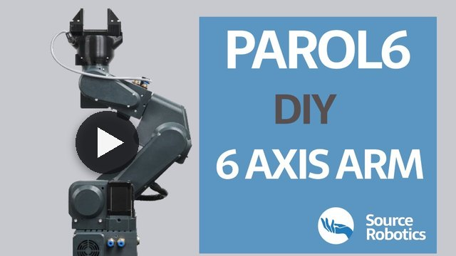

  

<h1 align="center">PAROL6</h1>

  <b>Open-source 3D-printed 6-axis desktop robot arm.</b> 
  Built like an industrial robot, in its mechanics, its control software and the way you use it.

  <a href="https://source-robotics.com/products/parol6-robotic-arm"><b>Buy</b></a>&nbsp;&nbsp;·&nbsp;&nbsp;
  <a href="https://docs.source-robotics.com/PAROL-docs/"><b>Documentation</b></a>&nbsp;&nbsp;·&nbsp;&nbsp;
  <a href="https://docs.source-robotics.com/PAROL-docs/latest/build/"><b>Build guide</b></a>&nbsp;&nbsp;·&nbsp;&nbsp;
  <a href="https://github.com/Source-Robotics/PAROL6-Desktop-robot-arm/releases/latest"><b>Download</b></a>&nbsp;&nbsp;·&nbsp;&nbsp;
  <a href="https://discord.com/invite/prjUvjmGpZ"><b>Discord</b></a>

  
  
  
  

| **6 axes** | **408 mm** | **0.5 to 1 kg** | **0.1 mm** | **5.5 kg** |
|:-:|:-:|:-:|:-:|:-:|
| open-loop NEMA 17 steppers | reach to the flange | payload | repeatability | robot weight |

## Project overview

<table>
  <tr>
    <td width="55%" valign="middle">
      PAROL6 is a high-performance 3D-printed desktop robotic arm. The design approach of PAROL6 was to be similar
      to industrial robots in terms of mechanical design, control software, and usability. The control software,
      the GUI and the robot's STL files are open source.
        
      <a href="https://youtu.be/bbrFn3aFLaA"><b>&#9654;&#xFE0E;&nbsp; Watch PAROL6 in action</b></a>
    </td>
    <td width="45%" valign="middle">
      
    </td>
  </tr>
</table>

## Start here

| I want to | Go to |
|---|---|
| **Buy a kit or a built robot** | [source-robotics.com](https://source-robotics.com/products/parol6-robotic-arm) |
| **Build my own** | [BOM](BOM/) · [print files](STL/) · [print table](Print%20table/) · [building instructions](Building%20instructions/) · [build guide](https://docs.source-robotics.com/PAROL-docs/latest/build/) |
| **Set it up and make it move** | [Quick start](https://docs.source-robotics.com/PAROL-docs/latest/quick-start/) · [control board firmware](PAROL6%20control%20board%20main%20software/) |
| **Program it** | [Commander software](https://github.com/Source-Robotics/PAROL-commander-software) ([tested PCs](https://github.com/Source-Robotics/PAROL-commander-software/blob/main/confirmed_working_systems.md)) · [PAROL-Web-Commander](https://github.com/Jepson2k/PAROL-Web-Commander) (community) · [Python API](https://github.com/PCrnjak/PAROL6-python-API) ([legacy](https://github.com/PCrnjak/PAROL6-python-API-Alvar)) · [ROS 2 and MoveIt](https://github.com/Source-Robotics/PAROL6-ROS2-MOVEIT) |
| **Simulate it** | [URDF and MuJoCo models](parol6_description/) |
| **Add a gripper** | [SSG-48](https://github.com/Source-Robotics/SSG-48-adaptive-electric-gripper) · [MSG](https://github.com/Source-Robotics/MSG-compliant-AI-stepper-gripper) · [pneumatic and vacuum](https://docs.source-robotics.com/PAROL-docs/latest/end-effectors/) |

## In this repository

| Folder | What is in it |
|---|---|
| [`STL`](STL/) | every printed part, with the small print bed versions and the gripper holders |
| [`BOM`](BOM/) | the bill of materials, with a shop link and a reference image for every part |
| [`Building instructions`](Building%20instructions/) | the assembly manual (PDF) and its notes |
| [`Print table`](Print%20table/) | the print settings for each part |
| [`PAROL6 control board main software`](PAROL6%20control%20board%20main%20software/) | the control board firmware (PlatformIO) |
| [`PAROL6 control board test code`](PAROL6%20control%20board%20test%20code/) | the board's test firmware |
| [`parol6_description`](parol6_description/) | the URDF and MuJoCo models, from [robot_descriptions](https://github.com/Source-Robotics/robot_descriptions) |
| [`Extras`](Extras/) | Leap Motion hand control |

The [latest release](https://github.com/Source-Robotics/PAROL6-Desktop-robot-arm/releases/latest) has the print files,
the BOM and the instructions as ready downloads.

## Community

Ask in [Discussions](https://github.com/orgs/Source-Robotics/discussions), chat on
[Discord](https://discord.com/invite/prjUvjmGpZ), report a bug in
[Issues](https://github.com/Source-Robotics/PAROL6-Desktop-robot-arm/issues). See what others built in the
[community projects](community_projects.md), and follow Source Robotics:

## Safety, liability and disclaimer

This project includes experimental software, hardware designs, and assembly documentation that are still under
development and may contain bugs, errors, or incomplete features. By using, building, or modifying this project, you
acknowledge that:

* You use this project entirely at your own risk
* You are solely responsible for safe assembly, testing, and operation
* No guarantee is made regarding correctness, safety, or reliability
* The authors are not responsible for any damage, injury, or loss resulting from the use or misuse of this project
* Hardware performance and safety depend on user assembly, component quality, calibration, and handling, which cannot be guaranteed
* This project is provided “as is.” If you choose to build a device yourself using these files, designs, or instructions, you do so without any warranties or guarantees, including regarding safety, reliability, or suitability for any particular purpose.

> [!WARNING]
> THIS PROJECT INVOLVES LETHAL VOLTAGES AND OTHER SERIOUS HAZARDS THAT CAN CAUSE SEVERE INJURY. YOU MUST READ THE FULL [SAFETY WARNING AND DISCLAIMER DOCUMENT](SAFETY_WARNING_AND_DISCLAIMER.md)  BEFORE USING ANY PROJECT FILES. BY PROCEEDING, YOU ACKNOWLEDGE AND ACCEPT ALL RISKS AND AGREE TO USE THIS PROJECT ENTIRELY AT YOUR OWN RESPONSIBILITY.

## Licensing

The hardware, everything in this repository except the firmware, is under the
[CERN Open Hardware Licence Version 2 - Strongly Reciprocal](LICENSE) (CERN-OHL-S-2.0): the STL files, the BOM, the
building instructions, the print table and the robot models. The firmware in `PAROL6 control board main software` and
`PAROL6 control board test code` is under [GPL-3.0](PAROL6%20control%20board%20main%20software/LICENSE), and the
libraries in their `lib` folders keep their own licences. Until 4 November 2026 the whole repository was under GPL-3.0.

## Versions

Which release and control board you have, and what works with it: [VERSIONS.md](VERSIONS.md).
