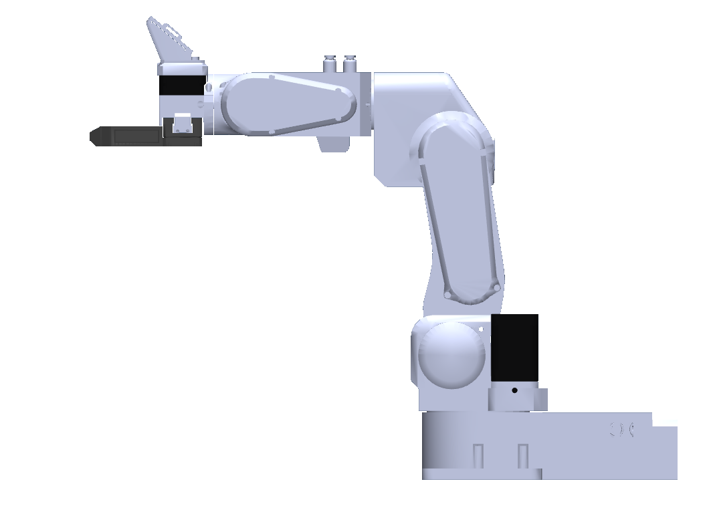
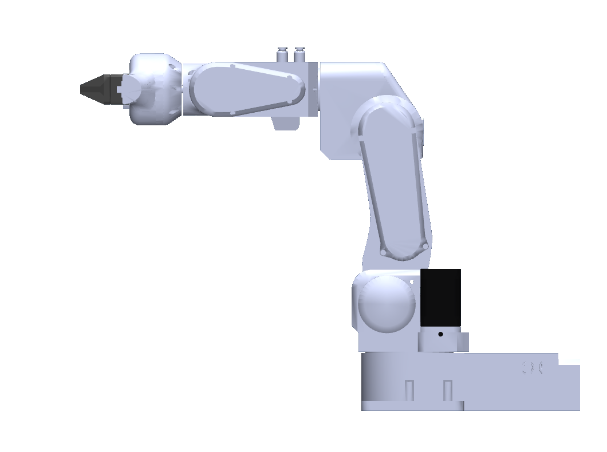

# PAROL6 models: getting started

[All models](https://github.com/Source-Robotics/robot_descriptions/blob/2f0629208057d258a47dd58354750c614e42c7be/README.md) | [MSG jaws](https://github.com/Source-Robotics/robot_descriptions/blob/2f0629208057d258a47dd58354750c614e42c7be/guides/msg.md) | [SSG48 jaws](https://github.com/Source-Robotics/robot_descriptions/blob/2f0629208057d258a47dd58354750c614e42c7be/guides/ssg48.md)

PAROL6 is available in **MuJoCo and URDF**, with all six configurations below.
The default `scene.xml` in the MuJoCo package opens the MSG with Solid jaws.

| PAROL6 with MSG | PAROL6 with SSG48 |
| --- | --- |
|  |  |

## 1. Download

- **MuJoCo:** [download parol6_mujoco.zip](https://github.com/Source-Robotics/robot_descriptions/releases/latest/download/parol6_mujoco.zip), then extract the `parol6/` folder.
- **URDF:** [download parol6_urdf.zip](https://github.com/Source-Robotics/robot_descriptions/releases/latest/download/parol6_urdf.zip), then extract the `parol6_description/` folder.

Keep each extracted folder intact; the model files use relative paths to meshes
and textures. No CAD tools or source build are needed to use these downloads.

## 2. Choose an end effector

| End effector | MuJoCo entry file | URDF entry file |
| --- | --- | --- |
| Flange only | [`scene_flange.xml`](https://github.com/Source-Robotics/robot_descriptions/blob/2f0629208057d258a47dd58354750c614e42c7be/mujoco/parol6/scene_flange.xml) | [`parol6_flange.urdf`](https://github.com/Source-Robotics/robot_descriptions/blob/2f0629208057d258a47dd58354750c614e42c7be/urdf/parol6_description/parol6_flange.urdf) |
| MSG - Solid jaws (default) | [`scene_msg.xml`](https://github.com/Source-Robotics/robot_descriptions/blob/2f0629208057d258a47dd58354750c614e42c7be/mujoco/parol6/scene_msg.xml) | [`parol6_msg.urdf`](https://github.com/Source-Robotics/robot_descriptions/blob/2f0629208057d258a47dd58354750c614e42c7be/urdf/parol6_description/parol6_msg.urdf) |
| MSG - Soft TPU jaws | [`scene_msg_tpu_glue.xml`](https://github.com/Source-Robotics/robot_descriptions/blob/2f0629208057d258a47dd58354750c614e42c7be/mujoco/parol6/scene_msg_tpu_glue.xml) | [`parol6_msg_tpu_glue.urdf`](https://github.com/Source-Robotics/robot_descriptions/blob/2f0629208057d258a47dd58354750c614e42c7be/urdf/parol6_description/parol6_msg_tpu_glue.urdf) |
| SSG48 - Solid jaws (default) | [`scene_ssg48.xml`](https://github.com/Source-Robotics/robot_descriptions/blob/2f0629208057d258a47dd58354750c614e42c7be/mujoco/parol6/scene_ssg48.xml) | [`parol6_ssg48.urdf`](https://github.com/Source-Robotics/robot_descriptions/blob/2f0629208057d258a47dd58354750c614e42c7be/urdf/parol6_description/parol6_ssg48.urdf) |
| SSG48 - Fin-ray jaws | [`scene_ssg48_stock.xml`](https://github.com/Source-Robotics/robot_descriptions/blob/2f0629208057d258a47dd58354750c614e42c7be/mujoco/parol6/scene_ssg48_stock.xml) | [`parol6_ssg48_stock.urdf`](https://github.com/Source-Robotics/robot_descriptions/blob/2f0629208057d258a47dd58354750c614e42c7be/urdf/parol6_description/parol6_ssg48_stock.urdf) |
| Pneumatic gripper | [`scene_pneumatic.xml`](https://github.com/Source-Robotics/robot_descriptions/blob/2f0629208057d258a47dd58354750c614e42c7be/mujoco/parol6/scene_pneumatic.xml) | [`parol6_pneumatic.urdf`](https://github.com/Source-Robotics/robot_descriptions/blob/2f0629208057d258a47dd58354750c614e42c7be/urdf/parol6_description/parol6_pneumatic.urdf) |

The links point to the source checkout. The downloaded packages contain the
same entry files. Each configuration includes the corresponding joints,
collision geometry, masses, materials and TCP frame.

## 3. Open the model

**MuJoCo:** open the selected `scene_*.xml` in your MuJoCo viewer. With the
Python MuJoCo package installed, this example runs from the directory where you
extracted the ZIP:

```bash
python -m mujoco.viewer --mjcf=parol6/scene_msg.xml
```

For a checkout of the central `robot_descriptions` repository, run this
from its root:

```bash
python -m mujoco.viewer --mjcf=mujoco/parol6/scene_msg.xml
```

The hardware repository's `parol6_description/` folder contains this guide
and previews. Extract the model download into a separate working directory
or ROS workspace to use the actual model package.

**URDF viewer:** open `parol6_description/parol6_msg.urdf`, keeping the
`meshes/` directory alongside it. If a web viewer asks for a ZIP or folder,
provide this one URDF package with all its assets.

**ROS 1 / RViz:** place the extracted `parol6_description` package in
`catkin_ws/src`, build and source that workspace, then run:

```bash
roslaunch parol6_description display.launch end_effector:=msg
```

Replace `msg` with any file suffix in the table. The supplied launch files are
ROS 1 files; a ROS 2 consumer can use the URDF with its own launch setup.

## 4. Check dimensions and frames

- [Dimensioned PAROL6 review sheets](https://github.com/Source-Robotics/robot_descriptions/blob/2f0629208057d258a47dd58354750c614e42c7be/mujoco/parol6/KINEMATIC_REVIEW.md)
- [PAROL6 DH convention](https://github.com/Source-Robotics/robot_descriptions/blob/2f0629208057d258a47dd58354750c614e42c7be/mujoco/parol6/DH.md)
- [PAR6 / PAROL6 comparison](https://github.com/Source-Robotics/robot_descriptions/blob/2f0629208057d258a47dd58354750c614e42c7be/reports/par6_parol6_kinematics.md)
- [Mass, COM and inertia status](https://github.com/Source-Robotics/robot_descriptions/blob/2f0629208057d258a47dd58354750c614e42c7be/mujoco/parol6/DYNAMICS.md)
- [Actuator settings](https://github.com/Source-Robotics/robot_descriptions/blob/2f0629208057d258a47dd58354750c614e42c7be/mujoco/parol6/ACTUATION.md)
- [Pneumatic jaw motion and controls](https://github.com/Source-Robotics/robot_descriptions/blob/2f0629208057d258a47dd58354750c614e42c7be/mujoco/parol6/PNEUMATIC.md)

`flange` is the physical tool-mounting face; `tcp` is the configured control
frame. Jaw-specific grasp centers have not been calibrated. PAR6 and PAROL6
share the public joint conventions and a 177 mm forearm; their shorter/longer
wrist housings require different flange offsets.

## Updating an older model

The shared repository replaces the older model folder in the PAROL6 hardware
repository. File locations and some public joint names have changed. See the
[name migration table](https://github.com/Source-Robotics/robot_descriptions/blob/2f0629208057d258a47dd58354750c614e42c7be/urdf/parol6_description/MIGRATION.md) and
[legacy-folder migration guide](https://github.com/Source-Robotics/robot_descriptions/blob/2f0629208057d258a47dd58354750c614e42c7be/guides/legacy-models.md) before updating existing code.

## Maintained model source

This folder contains the product guide and preview images. Download the runtime
model packages using the links above and extract them into your working directory.
All model files are maintained in [robot_descriptions](https://github.com/Source-Robotics/robot_descriptions);
this hardware repository has no model submodule to initialize.

Current tested model release: **[v2.13.0](https://github.com/Source-Robotics/robot_descriptions/releases/tag/v2.13.0)**.
See the [shared product guide](https://github.com/Source-Robotics/robot_descriptions/blob/2f0629208057d258a47dd58354750c614e42c7be/guides/parol6.md)
for the corresponding central documentation.
